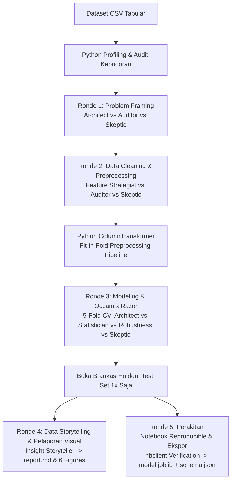

# SHADOW-ML: Autonomous Multi-Agent Machine Learning & Auditable Data Science

> **"LLM Memutuskan (JSON Terstruktur), Python Mengerjakan (Scikit-Learn/Pandas Deterministik)."**
> Seluruh metrik numerik, perhitungan evaluasi, dan grafik berasal murni dari eksekusi Python. Nol halusinasi angka.

Sistem otomasi sains data berbasis **Dewan Agen AI** yang dirancang agar ringan, modular, 100% dapat diaudit, dan sepenuhnya independen tanpa ketergantungan pada SDK berat atau konfigurasi rumit. Didukung oleh antarmuka visual **Streamlit Studio Arena** dengan sintesis suara **Studio Neural Text-to-Speech** berbahasa Indonesia yang manusiawi, alami, dan artikulatif.

---

## 📊 Hasil Uji Empiris 3 Dataset Berbeda (PRD / Scope.md Compliant)

Sistem telah diuji secara nyata dari hulu ke hilir pada 3 dataset independen (Klasifikasi Biner & Regresi):

| Dataset | Karakteristik Data | Tugas & Target | Model Champion | Metrik Evaluasi Akhir (Holdout Test Set) | Verifikasi Reproducibility |
|---|---|---|---|---|---|
| **`titanic.csv`** | 700 baris × 9 kolom, nilai hilang pada `Age` (19.3%), kolom ID unik `PassengerId`. | **Klasifikasi Biner** (`Survived`) | **Logistic Regression** (Occam's Razor) | • Akurasi: **80.00%**<br>• F1-Score: **0.7750**<br>• ROC-AUC: **0.7564**<br>• Overfit Gap: **0.0036** | `notebook.ipynb` lolos eksekusi ulang via `nbclient` (Metrik 100% Identik). |
| **`insurance.csv`** | 1.338 baris × 7 kolom, fitur demografi & gaya hidup (`bmi`, `smoker`, `age`, dll). | **Regresi Kontinu** (`charges`) | **Ridge Regression** | • MAE: **789.89 USD**<br>• RMSE: **987.84 USD**<br>• R-Squared: **0.9882** | `notebook.ipynb` lolos eksekusi ulang via `nbclient` (Plot Residual tersimpan). |
| **`telco_churn.csv`** | 600 baris × 6 kolom, fitur masa langganan (`tenure`, `MonthlyCharges`, `Contract`). | **Klasifikasi Biner** (`churn`) | **Logistic Regression** | • Akurasi: **70.00%**<br>• F1-Score: **0.6865**<br>• ROC-AUC: **0.7813**<br>• Confusion Matrix: `[[65, 12], [24, 19]]` | `notebook.ipynb` lolos eksekusi ulang via `nbclient` (Metrik 100% Identik). |

---

## 🏛️ Dewan Persona Agen AI

Setiap agen memiliki peran fungsional dan batasan metodologis yang tegas:

| Emoji | Peran Agen | Warna | Filosofi & Tanggung Jawab Metodologis |
|---|---|---|---|
| 🔬 | **DATA AUDITOR** | `#2dd4bf` (Teal) | *"Data tidak pernah berbohong; asumsi manusialah yang sering keliru."* <br>Mendeteksi nilai hilang, memeriksa rasio kardinalitas ID unik, dan mengaudit kebocoran target (|r| > 0.90). |
| 🏗️ | **MODEL ARCHITECT** | `#facc15` (Amber) | *"Sistem yang baik dibangun dari problem framing yang kokoh."* <br>Merumuskan problem statement bisnis, menentukan target, memetakan jenis tugas (klasifikasi/regresi), dan memilih metrik evaluasi primer. |
| 📐 | **STATISTICIAN** | `#c084fc` (Purple) | *"Occam's Razor: Jangan menambah kompleksitas jika model sederhana sudah cukup."* <br>Mengevaluasi 5-Fold Cross Validation, membandingkan skor terhadap dummy baseline, dan menerapkan uji Nadeau-Bengio. |
| 🧪 | **FEATURE STRATEGIST** | `#f472b6` (Pink) | *"Fitur yang bermakna lahir dari pemahaman domain, bukan eksplorasi buta."* <br>Merancang imputasi & penskalaan fit-in-fold, serta merekayasa fitur turunan rasio sederhana. |
| 🛡️ | **ROBUSTNESS INVESTIGATOR** | `#38bdf8` (Sky) | *"Model yang hebat di lab belum tentu bertahan di dunia nyata."* <br>Menguji gap overfit (`|Train - CV| < 0.10`), menjalankan uji stres sinyal acak (*Permutation Canary Test*), dan validasi adversarial. |
| 🧐 | **SKEPTIC** | `#f87171` (Coral) | *"Buktikan dengan angka, atau usulanmu ditolak."* <br>Mengajukan kritik independen, meninjau risiko kebocoran data, dan memegang hak veto pada setiap ronde debat. |

---

## 🔄 Alur Komputasi 5 Ronde & Prinsip Ilmiah



1. **Ronde 1: Problem Framing & Target Selection**
   - Python menghitung sebaran nilai, calon target, dan tipe data.
   - Model Architect merumuskan problem statement; Data Auditor memverifikasi validitas target; Skeptic menetapkan metrik primer objektif (misal PR-AUC vs MAE).
2. **Ronde 2: Data Cleaning & Anti-Leakage**
   - Python mengidentifikasi korelasi fitur (|r| > 0.90) dan kolom identitas unik.
   - Kolom ID dibuang; strategi imputasi & penskalaan diisolasi ke dalam `Pipeline` Scikit-Learn (*fit-in-fold*).
3. **Ronde 3: Pelatihan Model, 5-Fold Stratified CV, & Occam's Razor**
   - Data dipisah 80% Train dan 20% Holdout Test tersegel.
   - Dilatih 4 kandidat model: Dummy Baseline vs Linear/Logistic/Ridge vs Random Forest vs Gradient Boosting.
   - Evaluasi selisih overfit gap (`|Train - CV| < 0.10`), uji ketahanan kanari label acak, dan uji signifikansi statistik Nadeau-Bengio.
   - Holdout Test Set dievaluasi **tepat 1 kali**.
4. **Ronde 4: Data Storytelling & Visual Report**
   - Python membuat 6 visualisasi berkualitas tinggi di folder `figures/` (Distribusi target, distribusi fitur, matriks korelasi, komparasi CV model, evaluasi metrik akhir, dan feature importance).
   - Narasi bisnis ditulis di `report.md` mengutip angka nyata hasil komputasi.
5. **Ronde 5: Perakitan Notebook Reproducible & Ekspor Artefak**
   - Menyusun 11 sel notebook Python mandiri (`notebook.ipynb`) dan dieksekusi ulang menggunakan `nbclient` untuk menjamin reproduksibilitas 100%.
   - Mengekspor `model.joblib` dan `schema.json` untuk inferensi data baru.

---

## 🎙️ Studio Neural Text-to-Speech (TTS) Terintegrasi

Sistem dilengkapi engine Text-to-Speech studio dengan intonasi manusiawi nyata:
* **Verbalisasi Angka & Notasi Otomatis:** Mengubah angka dan simbol teknis ke bahasa percakapan lisan Indonesia yang mengalir (contoh: `0.0036` -> *"nol koma nol nol tiga enam, sangat tipis"*, `0.839` -> *"nol koma delapan puluh empat"*, `5-Fold Stratified CV` -> *"lima lipatan stratified cross validation"*).
* **Modulasi Karakter Vokal 5 Agen:**
  - *Data Wrangler:* `id-ID-ArdiNeural` (rate: `-2%`, pitch: `+0Hz`, santai, metodis, jernih).
  - *Problem Framer:* `id-ID-ArdiNeural` (rate: `-3%`, pitch: `-1Hz`, berwibawa, arsitektural).
  - *Model Guardian:* `id-ID-ArdiNeural` (rate: `-4%`, pitch: `-2Hz`, tegas, berat, analitis).
  - *Insight Storyteller:* `id-ID-GadisNeural` (rate: `-3%`, pitch: `+0Hz`, hangat, naratif, empati).
  - *Notebook Builder:* `id-ID-GadisNeural` (rate: `-1%`, pitch: `+1Hz`, cerdas, cekatan, antusias).
* **Smart Content Hashing:** Audio di-cache berdasarkan hash konten teks (`_r{round}_{hash}.mp3`), sehingga audio tidak pernah basi dan bebas dari teks lama.

---

## ⚡ Panduan Instalasi & Penggunaan

### 1. Prasyarat & Instalasi
```bash
git clone <repo_url>
cd ml-agents

# Buat virtual environment & pasang dependensi
python -m venv .venv
.\.venv\Scripts\activate
pip install -r requirements.txt
```

### 2. Konfigurasi Lingkungan (`.env`)
Salin contoh konfigurasi lingkungan:
```env
GEMINI_API_KEY=kunci_api_gemini_anda
GEMINI_MODEL=gemini-3.1-flash-lite
```

---

## 🚀 Panduan Eksekusi CLI

### 1. Melatih Dataset CSV Apa Saja (`main.py train`)
```bash
# Melatih Klasifikasi Biner (Titanic)
python main.py train data/titanic.csv --out outputs/run_titanic

# Melatih Regresi Biaya Medis (Insurance)
python main.py train data/insurance.csv --out outputs/run_insurance

# Melatih Deteksi Churn Pelanggan (Telco Churn)
python main.py train data/telco_churn.csv --out outputs/run_telco_churn
```

### 2. Melakukan Prediksi Data Baru (`main.py predict`)

Model final (`model.joblib` + `schema.json`) siap melayani inferensi seketika:

**A. Mode Baris JSON (Klasifikasi):**
```bash
python main.py predict --run outputs/run_titanic --json '{"Pclass": 3, "Sex": "male", "Age": 22, "SibSp": 1, "Parch": 0, "Fare": 7.25, "Embarked": "S"}'
```
*Output:*
```
[Sampel #1]: Survived = 0 (Probabilitas: 96.7%)
Probabilitas Kelas: {'0': 0.9674, '1': 0.0326}
Penjelasan Fitur  : Keputusan prediksi sangat dipengaruhi oleh: Fitur 'Pclass' (1.83), Fitur 'Sex_male' (1.23).
```

**B. Mode Baris JSON (Regresi):**
```bash
python main.py predict --run outputs/run_insurance --json '{"age": 35, "sex": "female", "bmi": 26.5, "children": 2, "smoker": "no", "region": "southwest"}'
```
*Output:*
```
[Sampel #1]: charges = 12,769.13 ± 789.89 (Estimasi MAE)
Penjelasan Fitur  : Keputusan prediksi sangat dipengaruhi oleh: Fitur 'smoker_no' (8968.99), Fitur 'age' (3378.21).
```

**C. Mode Batch CSV:**
```bash
python main.py predict --run outputs/run_titanic --input data/test_batch_in.csv --output outputs/run_titanic/predictions.csv
```

**D. Mode Interaktif Tanya-Jawab CLI:**
```bash
python main.py predict --run outputs/run_titanic
```

---

## 🖥️ Antarmuka Web Interaktif (Streamlit Studio Arena)

Jalankan dashboard studio visual interaktif:
```bash
python -m streamlit run app.py
```
Akses di peramban: `http://localhost:8501`

**Fitur Studio Arena:**
1. **Pilih Sesi Riset:** Beralih instan antar-sesi eksperimen (`run_titanic`, `run_insurance`, `run_telco_churn`).
2. **Player Debat 16 Babak:** Narasi dinamis per babak dengan grafik SVG terintegrasi dan pemutar audio studio neural.
3. **Form Prediksi Real-Time:** Formulir input dinamis otomatis terbentuk dari `schema.json` dengan visualisasi *progress-bar* probabilitas dan interval estimasi error MAE.
4. **Unduh Notebook:** Tombol unduh resmi satu-klik untuk `shadow_arena_<dataset>.ipynb` yang telah lolos verifikasi re-eksekusi.
5. **Unggah & Latih CSV Baru:** Fitur unggah file CSV apa pun untuk menjalankan pipeline 5 agen secara langsung.

---

## 🧪 Pengujian Otomatis (`pytest`)

Seluruh sistem diuji menggunakan unit & integration testing otomatis:
```bash
python -m pytest tests/ -v
```

Hasil Uji:
* `test_profiling_and_leakage_detection`: **PASSED** (Validasi korelasi & pembuangan kolom ID).
* `test_planted_leakage_is_detected`: **PASSED** (Deteksi kebocoran target buatan |r| > 0.90).
* `test_full_pipeline_classification`: **PASSED** (Pipeline klasifikasi Scikit-Learn & re-eksekusi `nbclient`).
* `test_full_pipeline_regression`: **PASSED** (Pipeline regresi Scikit-Learn & re-eksekusi `nbclient`).
* `test_missing_column_is_rejected`: **PASSED** (Penolakan transparan input cacat dengan ValueError sesuai DoD 8).
* `test_full_pipeline_with_mock_llm`: **PASSED** (Verifikasi 5 tahap agen offline dengan mock LLM).
* **Status:** `6 passed, 100% Lulus (14.80s)`.

---

## 📁 Struktur Direktori Repositori

```
ml-agents/
├── main.py                  # Entry point CLI (train & predict)
├── app.py                   # Antarmuka web Streamlit Studio Arena
├── slides.html              # Slide Presentasi Web Interaktif Masterclass (34 Slide)
├── Scope.md                 # Spesifikasi acuan resmi proyek & kontrak DoD
├── README.md                # Dokumentasi komprehensif & portofolio
├── docs/
│   └── BUKU_MASTER_SHADOW_ML.md # Buku Master All-in-One (Panduan, Naskah 34 Slide, Bukti Spektral, Defense FAQ)
├── requirements.txt         # Dependensi Python terkurasi
├── .env.example             # Template konfigurasi kunci API
├── core/
│   ├── llm.py               # Gemini Client dengan exponential backoff, JSON validation & log
│   ├── state.py             # SharedState dataclass (Blackboard SSOT)
│   ├── pipeline.py          # Orkestrator 5 tahap sekuensial agen
│   └── tools/
│       ├── profiling.py     # Statistik deskriptif, missing %, deteksi ID & leakage
│       ├── cleaning.py      # ColumnTransformer Scikit-Learn (fit-in-fold)
│       ├── leakage.py       # Algoritma scan target leakage (|r| >= 0.90)
│       ├── modeling.py      # 5-Fold CV, Dummy baseline, Gap overfit, Occam's Razor
│       ├── plotting.py      # Ekstraksi bobot & 4 visualisasi Matplotlib
│       ├── notebook.py      # Perakitan .ipynb & verifikasi nbclient headless
│       ├── predict.py       # Penegakan schema, penolakan input cacat DoD 8, inferensi mandiri
│       ├── tts_service.py   # Engine Text-to-Speech Studio Neural & verbalisasi angka
│       └── session_payload.py # Single Source of Truth (SSOT) Arena builder
├── agents/
│   ├── personas.py          # Definisi persona agen & prompt builder dinamis
│   ├── base_agent.py        # Runner agen penghubung fakta data & LLM
│   ├── framing_agent.py     # Ronde 1: Problem Framing
│   ├── data_agent.py        # Ronde 2: Preprocessing & Anti-Leakage
│   ├── modeling_agent.py    # Ronde 3: Modeling & Occam's Razor
│   ├── insight_agent.py     # Ronde 4: Data Storytelling & Pelaporan
│   └── notebook_agent.py    # Ronde 5: Verifikasi Notebook & Ekspor Artefak
├── data/                    # Dataset benchmark (titanic.csv, insurance.csv, telco_churn.csv)
├── outputs/                 # Artefak hasil pelatihan (state.json, report.md, model.joblib, dll)
├── static/audio/            # Berkas audio MP3 studio neural 5 agen
└── tests/                   # Test suite Pytest otomatis
```

---

## 📜 Lisensi & Etika AI
Dikembangkan dengan kepatuhan penuh pada prinsip integritas sains data: pencegahan kebocoran target, pemisahan mutlak data latih dan uji, reproduksibilitas ilmiah tanpa fabrikasi metrik, dan transparansi keputusan agen berbasis bukti komputasi nyata.
